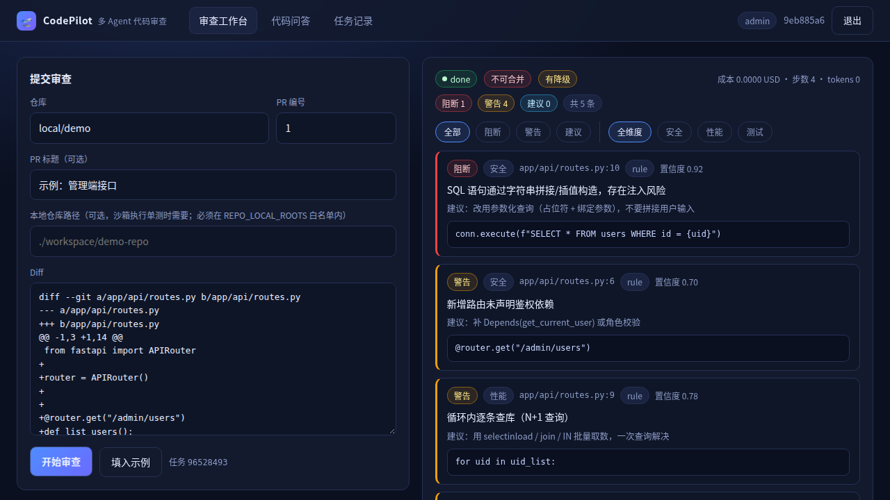
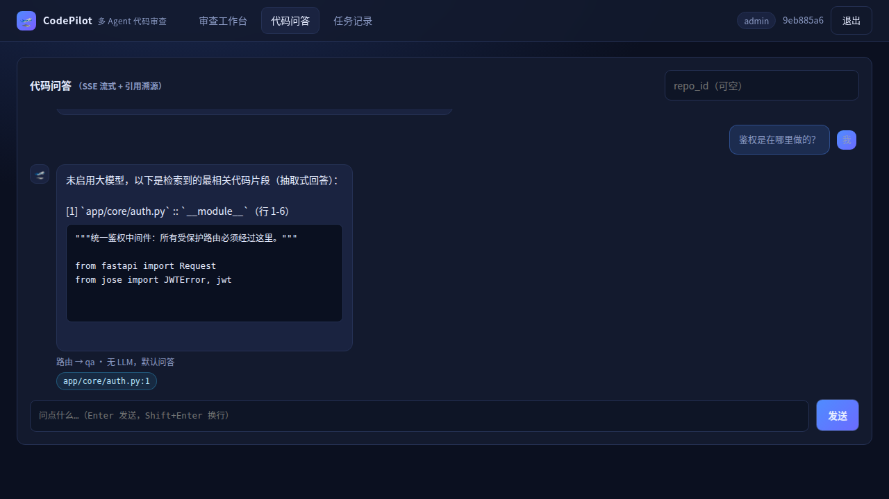

# CodePilot · 多 Agent 研发协作与代码审查平台

<p align="center">
  <b>PR 四维并行审查 · 代码库 RAG 问答 · 单测生成 + Docker 沙箱</b><br/>
  FastAPI · LangGraph · PostgreSQL · Redis · Milvus · Docker
</p>

> 一个能真正跑起来、能演示、能讲清楚的多 Agent 项目。
> 从课程项目 EduAgent 的四种范式（并行 / RAG / HitL / 状态机）迁移到研发场景，
> 迁移方法与逐条对照见 [docs/MAPPING.md](docs/MAPPING.md)。

---

## 它解决什么问题

研发团队的三个老问题：

1. **PR 评审慢且标准不一** —— 安全、性能、规范、测试四个维度靠人肉看，漏报和重复告警都多；
2. **新人不懂内部规范** —— 代码库、架构文档、历史 PR 里的知识检索不到；
3. **单测覆盖不足** —— 写了跑不通，跑通了没人看，最后没人写。

CodePilot 用三个 Agent 把这条链路串起来，**主干是确定的有向图，Agent 只在节点内部有自主权**：
不追求「全自主」，但每一步都可解释、可降级、可人工兜底。

| 能力 | 入口 | 关键实现 |
|---|---|---|
| PR 四维并行审查 | Webhook / API / Chat | LangGraph `Send` 扇出 + 规则引擎 + 证据校验 + 阻断门 |
| 代码库 RAG 问答 | API / Chat（SSE） | 函数级切分 + dense/sparse 混合召回 + RRF + 精排 + 引用校验 |
| 单测生成与验证 | API / Chat | diff 识别新增函数 → LLM 生成 → 沙箱 `pytest --cov` → `interrupt` 人工确认 |

---

## 界面

| 审查工作台 | 代码问答 |
|---|---|
|  |  |

打开 `http://localhost:8000/` 即是前端（Vue 3 + Vite 构建，FastAPI 同源托管，不需要额外的 nginx 容器）。
三个页签：**审查工作台**（提交 diff / 轮询状态 / 按严重度与维度过滤 / HitL 确认）、
**代码问答**（SSE 流式 + 引用可点）、**任务记录**（历史任务与报告回看）。

改前端：

```bash
cd frontend
npm install
npm run dev        # http://localhost:5173，/api 自动代理到 8000
npm run build      # 产物在 frontend/dist，FastAPI 直接托管
```

`frontend/dist` 已提交，clone 下来不需要装 Node 就能跑。

---

## 快速开始（5 分钟）

```bash
git clone <your-repo-url> codepilot && cd codepilot

# 1. 配置
cp .env.example .env.local
#    至少填：LLM_API_KEY（DeepSeek / 任意 OpenAI 兼容）
#    想完全离线演示：LLM_PROVIDER=mock（只跑确定性规则引擎）

# 2. 基础设施（PostgreSQL + Redis + Milvus + Attu）
docker compose up -d
make sandbox-image            # 构建单测沙箱镜像

# 3. 依赖 + 初始化
python3.11 -m venv .venv && make install
make seed                     # 演示账号 codepilot / codepilot123
make api                      # http://localhost:8000/docs

# 4. 跑一次端到端审查（另开终端）
make demo
```

期望结果：一个含**硬编码密钥 / SQL 注入 / 循环内 IO / 吞异常 / eval / 缺鉴权**的 demo diff，
返回 6~8 条 findings，其中 3 条 `block`，`mergeable=false`。

> 没有 API Key 也能跑：`LLM_PROVIDER=mock` 时四维审查走 15 条确定性规则，
> RAG 返回抽取式答案，单测链路跳过（不调用 LLM）。CI 就是这么跑的。

---

## 模型配置（一个 provider，多个槽位）

`.env.local` 里 LLM 只有 **1 个 provider**（DeepSeek / 任意 OpenAI 兼容网关 / mock），
但模型名分 **2 个基础槽 + 5 个可选覆盖槽**，不配覆盖就自动回落：

| 槽位 | 环境变量 | 默认回落 | 谁在用 |
|---|---|---|---|
| chat | `LLM_MODEL_CHAT` | `deepseek-chat` | 分诊、RAG 回答、查询改写、意图路由、摘要 |
| code | `LLM_MODEL_CODE` | `deepseek-chat` | 四维审查、单测生成 |
| review | `LLM_MODEL_REVIEW` | code 槽 | 安全/性能/规范/测试四个 reviewer |
| testgen | `LLM_MODEL_TESTGEN` | code 槽 | 单测生成 |
| triage | `LLM_MODEL_TRIAGE` | chat 槽 | PR 分诊（7B 小模型就够） |
| rag | `LLM_MODEL_RAG` | chat 槽 | 问答与 HyDE 改写 |
| router | `LLM_MODEL_ROUTER` | chat 槽 | 统一入口意图分类 |

```ini
# 例：审查用强模型，其余用便宜模型
LLM_MODEL_REVIEW=deepseek-reasoner
LLM_MODEL_CHAT=deepseek-chat
# 换模型后同步改单价，否则成本数字不准（USD / 1M tokens）
LLM_PRICE_INPUT_PER_M=0.55
LLM_PRICE_OUTPUT_PER_M=2.19
```

解析结果可以直接查：`curl -s localhost:8000/healthz | jq .models`。

另外还有两组**非 LLM** 模型配置，别混在一起：
- `EMBEDDING_BACKEND` / `EMBEDDING_MODEL` / `EMBEDDING_DIM`：向量化（hash / 本地 BGE-M3 / OpenAI 兼容）
- `RERANK_BACKEND` / `RERANK_MODEL`：精排（none / lexical / cross-encoder）

---

## 启动哪些容器

| 容器 | 镜像 | 端口 | 作用 |
|---|---|---|---|
| `codepilot-postgres` | postgres:16-alpine | `5434` | 业务表 + LangGraph checkpoint |
| `codepilot-redis` | redis:7-alpine | `6381` | 任务队列（Streams）+ 限流 |
| `codepilot-etcd` | etcd v3.5.14 | - | Milvus 元数据 |
| `codepilot-minio` | minio RELEASE.2023-03-20 | - | Milvus 对象存储 |
| `codepilot-milvus` | milvus v2.4.9 | `19532` | 向量库（不可用自动降级） |
| `codepilot-attu` | attu v2.4.12 | `30010` | 向量库可视化 |
| `codepilot-api` | 自建 | `8000` | HTTP / SSE |
| `codepilot-worker` | 自建 | - | 消费任务、跑图、调沙箱 |
| `codepilot/sandbox:py311` | 自建 | 一次性 | 跑生成的单测（断网、限额） |

只跑基础设施 + 本机应用：`docker compose up -d` + `make api`（推荐开发用）。

> 端口默认 `5434 / 6381 / 19532 / 30001`，特意避开了常见默认值和 EduAgent 课程项目占用的
> `5433 / 6380 / 19531 / 30000`。两个项目可以同时跑。
全容器：`docker compose -f docker-compose.yml -f docker-compose.app.yml up -d --build`
（app compose 需要和 infra compose 合并使用，因为 api/worker 依赖 infra 里的 postgres/redis）。
细节与生产加固：[docs/DEPLOY.md](docs/DEPLOY.md)。

---

## 架构

```
GitHub Webhook ──验签──┐
Manual / Chat ────────┤
                      ▼
                FastAPI (202) ──► Redis Streams ──► Worker
                                                    │
                                    ┌───────────────▼────────────────┐
                                    │ LangGraph Orchestrator（主图）  │
                                    │ route → review / qa / test     │
                                    │          （3 子图）             │
                                    └───────────────┬────────────────┘
        ┌───────────────────────────────────────────┼──────────────────────────────┐
        ▼                                           ▼                              ▼
  PR 审查子图                                  RAG 子图                    单测生成子图
  ingest → triage → retrieve                  rewrite → retrieve           generate → sandbox
   → Send 四维并行 → aggregate                 → answer → persist           → 回灌 ≤2 轮 → interrupt
   → testgen → sandbox → hitl → publish                                            → resume → done
        │                                           │                              │
        └──────────────► PostgreSQL / Milvus / Docker Sandbox ◄────────────────────┘
```

更细的状态设计、reducer 规则、降级矩阵：[docs/ARCHITECTURE.md](docs/ARCHITECTURE.md)。

---

## API 一览

| 方法 | 路径 | 说明 |
|---|---|---|
| POST | `/api/v1/auth/login` | 登录拿 JWT |
| GET | `/api/v1/auth/me` | 校验令牌 |
| POST | `/api/v1/webhooks/github` | PR webhook（HMAC 验签，202） |
| POST | `/api/v1/reviews` | 手动提交 diff 审查（202） |
| GET | `/api/v1/reviews/{id}` | 任务状态 + findings + 报告 |
| GET | `/api/v1/reviews` | 任务列表 |
| POST | `/api/v1/reviews/{id}/resume` | HitL 恢复（approve / reject / edit） |
| POST | `/api/v1/rag/ingest` | 给本地仓库建索引 |
| POST | `/api/v1/rag/query` | 代码库问答（带引用） |
| GET | `/api/v1/rag/repos` | 已索引仓库与 chunk 数 |
| POST | `/api/v1/chat` | 统一入口（SSE：route/citations/token/result/done） |
| GET | `/healthz` `/readyz` `/metrics` | 健康检查与指标 |
| GET | `/` | 前端工作台（Vue SPA） |

```bash
# 示例：登录 + 提交 diff
TOKEN=$(curl -s localhost:8000/api/v1/auth/login -H 'content-type: application/json' \
  -d '{"username":"codepilot","password":"codepilot123"}' | python3 -c 'import sys,json;print(json.load(sys.stdin)["access_token"])')

curl -s localhost:8000/api/v1/reviews -H "authorization: Bearer $TOKEN" \
  -H 'content-type: application/json' \
  -d "{\"repo\":\"local/demo\",\"diff\":$(python3 -c 'import json;print(json.dumps(open("demo.diff").read()))')}"
```

---

## 目录结构

```
backend/
  main.py / config.py / dependencies.py
  core/        logger(JSON) · exceptions(retryable) · llm_factory(mock/成本) · retry · security(JWT/HMAC)
  db/          session(asyncpg + AsyncPostgresSaver) · migrations
  agents/
    review/    state(reducer) · diff · rules(15条) · reviewers · nodes · graph · prompts · persist
    rag/       chunking(tree-sitter/正则) · embedding(hash/local/openai) · store(Milvus+PG) · retrieval(RRF+rerank) · graph
    testgen/   graph(生成→沙箱→回灌→interrupt)
    orchestrator/ router(规则+LLM) · graph(主图+4子图)
  infra/       queue(Streams/内存) · worker · sandbox(Docker断网) · github(webhook/评论) · guard(限流)
  api/v1/      auth · reviews · webhooks · rag_api · chat(SSE) · health
services/      review_service(建任务/跑图/恢复) · metrics
frontend/      Vue 3 + Vite（审查工作台 / 代码问答 / 任务记录），dist 随仓库提交
scripts/       init_db.sql · seed_data · ingest_repo · demo_review · eval_review
tests/         纯函数单测（diff/rules/reducer/chunking/router/security/sandbox）
docs/          ARCHITECTURE · MAPPING(EduAgent→CodePilot) · DEPLOY
```

---

## 设计取舍（面试最爱问的部分）

1. **为什么不用「全自主 Agent」**：主干确定、局部自主。检索要不要做、测试要不要生成、沙箱失败要不要进人工，
   这些是决策点用条件边；审查本身才交给模型。可解释、可测试、成本可控。
2. **规则引擎 + LLM 而不是纯 LLM**：机械问题（密钥、SQL 拼接、吞异常）规则零成本零抖动；
   LLM 只补需要语义理解的部分，prompt 里显式告知「已发现」，避免重复告警。
3. **证据校验**：LLM 的 evidence 必须能在 diff 里逐字命中，否则丢弃并计数。
   这是把「幻觉」变成可观测指标，而不是靠 prompt 祈祷。
4. **全链路降级**：Milvus / Redis / Docker / LLM 任意一个挂掉，服务都还能给出结果，只是标 `degraded`。
5. **单写者 + 幂等 reducer**：四个并行节点只往 `findings` 写，去重和排序在 reducer 里做一次，
   下游不用再处理重复；同样输入永远同样顺序，报告可 diff。
6. **成本闸门**：单维超时、token 预算、回灌 ≤2 轮、幂等键、新 commit 取消旧任务。

---

## 评测（别写没跑过的数字）

```bash
# 用人工标注的 diff 算 precision / recall / F1（只统计规则引擎，可复现）
python -m scripts.eval_review --cases eval/cases.json
```

当前仓库自带 3 个样本（`eval/`），实测：**precision 0.727 / recall 1.000 / F1 0.842**。
样本量很小，只能证明「评测链路是通的」，不代表生产效果 —— 请用自己团队的 PR 扩充 `eval/cases.json` 后再写数字。

检索质量、单 PR 成本、评审时长的 SQL 口径见 [docs/MAPPING.md](docs/MAPPING.md) 第四节。
**建议在 README 里贴你自己跑出来的数字和样本量，而不是抄模板。**

---

## 已知限制 / Roadmap

- [ ] GitLab 适配器（`repos.provider` 已留枚举，暂无实现）
- [ ] 多租户 RLS（当前靠查询条件隔离）
- [ ] 沙箱独立服务化（当前 worker 调宿主机 Docker）
- [ ] 前端：Markdown 完整渲染、diff 高亮、任务详情分享链接
- [ ] Contextual RAG（chunk 摘要增强）
- [ ] 评测集扩充 + LLM 维度自动化回归

---

## License

MIT。密钥、`.env.local`、`workspace/` 已在 `.gitignore` 中，请勿提交。
