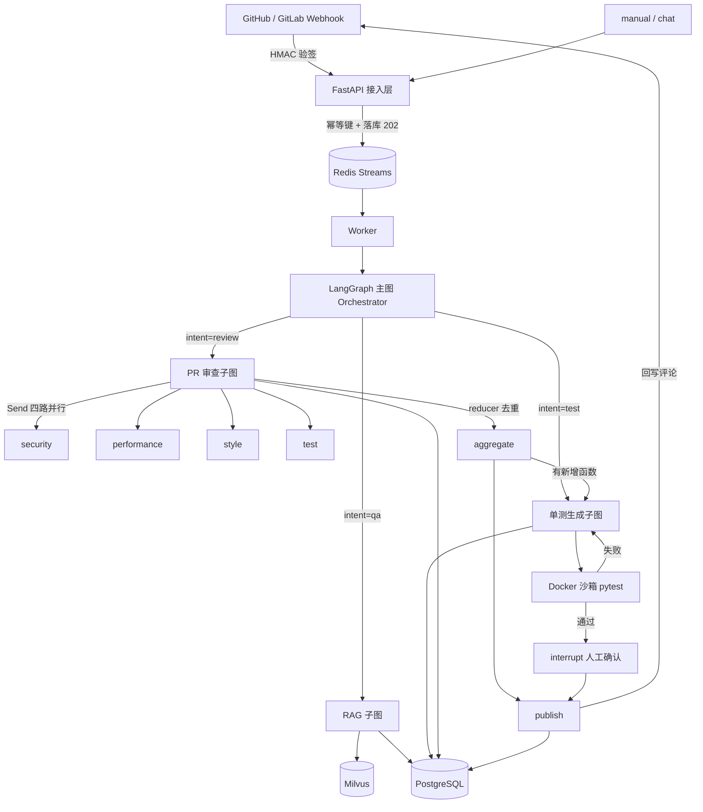

# 架构说明（CodePilot）

## 1. 一张图看清数据流



## 2. 状态设计（为什么这么切）

| 字段 | 作用 | 写入方 |
|---|---|---|
| `diff_text` | 原始 diff，节点各自解析 | ingest（只读） |
| `findings` | `Annotated[list[Finding], merge_findings]` | 4 个 review_one 并行写 |
| `dim_status` | 每维 ok / degraded / failed | 各维度独立写（key 不重叠） |
| `usage` | `Annotated[list[dict], operator.add]` | 并行节点追加 |
| `repo_ctx` | 检索到的规范/相似代码 | retrieve_ctx |
| `budget` | token / 成本 / 步数上限 | aggregate 汇总 |
| `test_patch` / `sandbox_report` / `hitl` | 单测链路 | testgen / sandbox / human_gate |
| `degraded` | 是否有降级 | 各节点（OR 合并） |

**四条硬规则**

1. 并行写入只能走 reducer，reducer 幂等且排序稳定（同样的输入永远同样的顺序）。
2. 任何节点失败都转成结构化状态，不裸抛异常穿透整张图。
3. 没有 evidence 的结论在证据校验或聚合阶段被丢弃。
4. state 只放决策需要的最小集；大文本落库/放对象存储，state 存引用。

## 3. 四维并行审查

- **规则引擎先跑**（`rules.py`，15 条规则，零 token），LLM 只找规则找不到的问题，prompt 里显式给出「已发现」避免重复。
- **单维隔离**：`asyncio.timeout` + 重试 + `dim_status`，一个维度超时不影响其他三个。
- **证据校验**：LLM 的 `evidence` 必须能在 diff 新增行里逐字找到，否则丢弃并计数（幻觉率可观测）。
- **跨维仲裁**：同文件同行同问题的重复只保留严重度最高的那条。
- **分级**：block / warn / info；任一 block → `mergeable=false`，PR 标记不可合并。

## 4. 混合检索（代码库 RAG）

```
question
  ├─ 规则/LLM 改写 → 3 条 query
  ├─ dense：BGE-M3 / hash → Milvus COSINE top-30
  ├─ sparse：PG tsvector('simple') + ts_rank_cd top-30
  ├─ RRF：score = Σ 1/(60+rank)
  ├─ 精排：lexical / bge-reranker（cross-encoder）
  └─ Top-K + 引用校验（[n] 必须存在）
```

- 切分：tree-sitter 函数级（退化路径为缩进感知正则），超过 120 行滑窗 + 12 行重叠。
- 稀疏侧额外写 40 行窗口，解决「函数很长但只匹配其中一段」的问题。
- 任一路挂掉 → `degraded=true`，用另一路结果继续，不让检索失败打断回答。

## 5. 沙箱与 HitL

- 镜像 `codepilot/sandbox:py311` 只装 pytest/pytest-cov 等运行依赖，不含业务代码。
- 执行参数：`--network none`、`--memory 512m`、`--cpus 1`、`--pids-limit 128`、`--cap-drop ALL`、`--security-opt no-new-privileges`、`--user uid:gid`、`--tmpfs /tmp`。
- 失败回灌 ≤2 轮；环境失败（docker 不可用/超时）→ 降级为「建议人工补测」，不阻断 PR。
- 沙箱通过 → `interrupt()` 挂起，`POST /reviews/{id}/resume` 触发 `Command(resume=...)`；
  PostgresSaver 保证进程重启后仍可从断点恢复。

## 6. 防死循环 / 防成本失控

| 机制 | 位置 | 行为 |
|---|---|---|
| 单维超时 | `reviewers.py` | 超时降级，不阻塞其他维度 |
| 步数上限 | `recursion_limit=40` + `budget.max_steps` | 超限中止并标记 degraded |
| token / 成本预算 | `budget` + `estimate_cost_usd` | 超预算不再调 LLM，降级为规则结果 |
| 回灌轮次 | `testgen_rounds < 2` | 最多重生成 2 轮 |
| 幂等键 | `(repo, pr, head_sha)` | 重复 webhook 不重复审查 |
| 新 commit 取消旧任务 | `review_tasks.status='superseded'` | 省成本、防结果错乱 |
| 仓库限流 | `infra/guard.py` | 60s 窗口 30 次 |

## 7. 降级矩阵

| 依赖 | 不可用时 | 用户感知 |
|---|---|---|
| LLM | 规则引擎全量跑 | 报告标 `degraded`，只有确定性结论 |
| Milvus | 纯 PG 全文检索 | 引用仍可用，语义召回变弱 |
| Redis | 进程内队列 | 单机可用，无法多副本 |
| Docker | 跳过沙箱 | `test_report.status=skipped` |
| Postgres Checkpointer | InMemorySaver（仅非生产） | 进程重启丢断点 |
| GitHub API | 审查照常，跳过评论 | 结果只在平台内可见 |
